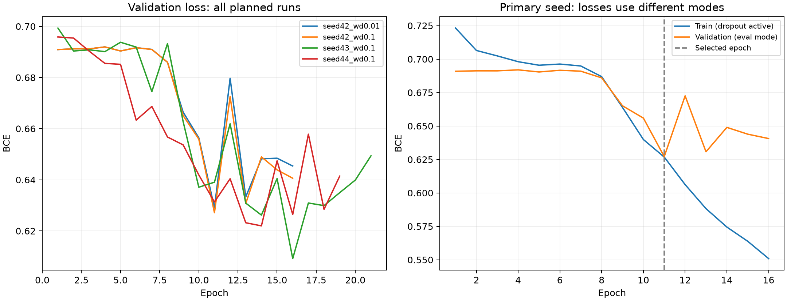

# 코디 궁합 모델 첫 GPU 학습 결과

2026-11-18 · RTX 3070 Ti 8GB · PyTorch 2.11.0+cu128 / torchvision 0.26.0+cu128.

## 결론

논문을 참고한 경량 궁합 모델을 공식 Polyvore 데이터로 실제 학습했다. 보류 테스트의 코디 분류 ROC-AUC는 이미지 기준 모델 0.642에서 기본 seed42 모델 0.701로 개선됐다. 3개 seed 평균은 0.724, seed 간 표준편차는 0.024다. 이 표준편차는 신뢰구간이 아니다.

다만 FITB(네 개 중 들어갈 옷 선택)는 기본 모델 37.3%로 이미지 기준 모델 39.1%보다 낮고, seed별 차이가 있다. 학습·검증 차이도 남았다. 따라서 추천 기능이 검증됐거나 과적합이 없다고 결론 내리지 않으며 **현재 웹의 Qwen 평가를 이 모델로 교체하지 않았다**. 새 사람 평가와 추천 과제 검증이 필요한 연구용 체크포인트다.

## 실제 사용한 자료와 모델

- [WACV 2023 OutfitTransformer](https://openaccess.thecvf.com/content/WACV2023/html/Sarkar_OutfitTransformer_Learning_Outfit_Representations_for_Fashion_Recommendation_WACV_2023_paper.html)의 전체 코디 관계·outfit token·self-attention 분류 구조를 참고했다. 원본 논문 전체 재현이나 공개 OutfitTransformer 가중치 사용은 아니다. 텍스트 인코더·전용 검색 손실·curriculum은 사용하지 않았다.
- [ECCV 2018 Type-Aware Embeddings](https://github.com/mvasil/fashion-compatibility)의 Polyvore benchmark와 궁합/유사성 구분을 참고했다. 원본 ECCV 모델의 triplet/text 학습을 재현한 것은 아니다.
- [공식 Polyvore 데이터](https://huggingface.co/datasets/mvasil/polyvore-outfits), revision `22cc0c748c293a598e1df561a76abe96273cb76a`. 승인된 사용자 토큰으로 disjoint parquet, 원본 코디, compatibility/FITB 문항 등 15개 파일을 받았다. 토큰은 출력하지 않았고 데이터/가중치와 함께 Git에서 제외했다.
- 동결 [ResNet18 IMAGENET1K_V1](https://docs.pytorch.org/vision/stable/models/generated/torchvision.models.resnet18.html) 이미지 특징 512차원 → LayerNorm → 128차원 projection + 의류 종류 embedding → 2층/4-head Transformer → BCE 분류. 학습 파라미터는 332,673개다. 기존 Qwen 모델을 미세조정한 것이 아니라 별도 궁합 헤드를 학습했다.
- 정답은 원본 curated outfit 양성 / 합성 부정 예제다. 사람의 절대적인 미적 호불호 정답이 아니다. Qwen 결과를 학습 정답으로 만들지 않았다.

## 누수 검사

원본 파일에 포함된 이미지 수: train 71,967 / validation 14,657 / test 70,035. **disjoint라는 이름만 신뢰하지 않고 실제 파일을 검사했다.**

| 검사 | 결과 |
|---|---:|
| 학습–검증 공유 item ID | 3,781 |
| 학습–테스트 공유 item ID | 84 |
| 검증–테스트 공유 item ID | 34 |
| 분할 간 공유된 item ID 합집합 | 3,849 |
| 분할 간 같은 원본/정규화 픽셀 해시 그룹 | 3,899 |
| 분할 간 dHash+종횡비 같은 유사 후보 그룹 | 5,220 |
| 전체 제외 item ID | 10,690 |

동일 ID·원본 SHA256·EXIF 정규화 RGB 픽셀 SHA256·dHash 유사 후보가 분할을 넘으면 관련 항목을 모든 분할에서 제외했다. 이전 등록 사진 60장과 겹치는 유사 후보 1개도 제외했다. 이는 실제 동일 사진임을 확정한 숫자가 아니다. dHash 충돌은 다른 옷일 수도 있으며, 모든 크롭·변형·다른 각도의 동일 의류를 검출하는 방법도 아니다. 실제 의류 단위의 완전한 독립성을 보장하지 않는다.

중복/충돌 코디, 동일 아이템 반복, 2–8개 범위를 벗어난 코디를 제외했다. FITB에서는 답 후보 ID가 중복된 테스트 문항 11개를 제거했다. 이 필터는 모델 점수에 근거하지 않는다.

| 정제 후 분할 | 코디 수 | 양성 | 음성 | FITB |
|---|---:|---:|---:|---:|
| 학습 | 17,492 | 8,728 | 8,764 | 학습 안 함 |
| 검증 | 917 | 426 | 491 | 147 |
| 테스트 | 23,238 | 11,630 | 11,608 | 10,227 |

정제 후 사용 예제 사이의 ID·원본/픽셀 해시·동일 dHash 후보 교집합이 없음을 assert로 확인했다. 정제에 따라 원 논문의 숫자와 직접 비교할 수 없는 별도 프로토콜이다. 검증셋이 작아졌고 필터에 따른 선택 편향 가능성이 있다.

## 과적합 방지와 선택 과정

- 이미지 인코더 동결, dropout 0.3, AdamW weight decay, gradient clip 1.0.
- seed42에서 weight decay 0.01 / 0.1만 비교하고 검증 BCE로 0.1 선택. 선택 설정을 seed43/44로 반복했다.
- 최대 30 epoch, 검증 BCE 개선이 5회 없으면 중지. 기본 모델은 epoch11 체크포인트를 사용했고 epoch16에서 중지했다. seed43/44는 각각 epoch16/14 체크포인트다.
- 검증 선택을 파일에 쓴 후 테스트 평가를 완료했다. 기본 seed는 미리 정한 42를 유지한다. 테스트가 가장 높았던 seed43을 제품 모델로 고르지 않았다.
- 초기 정규화 없는 pilot은 검증 AUC 약 0.57로 기준 모델에 못 미쳤다. 이미지 특징의 입력 스케일 보정을 한 번 추가했고 수정 이유·초기 결과를 별도 보존했다. 이 수정 결정에서 테스트 성능을 열람하지 않았다. 세부 기록은 [실험 프로토콜](OUTFIT_TRAINING_PROTOCOL.md)에 있다.

## 테스트 결과

ROC-AUC는 분류의 구분 능력이며 사용자 옷이 어울릴 확률이나 정확도 백분율이 아니다. FITB의 무작위 선택 기대값은 25%다.

| 모델 | 학습 AUC | 검증 AUC | 테스트 AUC | 테스트 AP | FITB 정확도 |
|---|---:|---:|---:|---:|---:|
| 카테고리만 쓰는 기준 모델 | 0.519 | 0.580 | 0.497 | 0.499 | 24.5% |
| 이미지 평균·분산 logistic 기준 모델 | 0.697 | 0.671 | 0.642 | 0.622 | 39.1% |
| Transformer seed42 · 기본 | 0.752 | 0.703 | 0.701 | 0.687 | 37.3% |
| Transformer seed43 | 0.850 | 0.758 | 0.750 | 0.741 | 42.3% |
| Transformer seed44 | 0.812 | 0.744 | 0.721 | 0.707 | 40.4% |

기본 모델의 학습–검증 AUC 차이는 약 0.050, 다른 seed는 약 0.092/0.068이다. 후반 epoch에서 학습 손실만 계속 낮아지고 검증 BCE는 악화되는 구간이 있어 조기 종료가 적용됐다. 과적합 징후를 제거했다고 주장할 수 없다. seed 차이와 FITB 기본 모델의 미개선 때문에 웹 추천으로 승격하지 않았다.

학습 및 최종 평가 단계는 약 60.2초, PyTorch peak allocated GPU 메모리는 약 123.6MiB다. 동결 이미지 추출·데이터 다운로드 시간과 GPU 드라이버/다른 앱 메모리는 이 숫자에 포함하지 않는다. 첫 특징 추출은 약 554초였고 초반 게임 경합이 있어 순수 성능 벤치마크로 사용하지 않는다.



왼쪽은 계획한 각 실행의 검증 BCE, 오른쪽은 기본 모델의 학습(dropout 활성) 및 검증(eval mode) BCE다. 두 모드의 손실을 그대로 동등한 값으로 비교하면 안 된다. 위 표의 학습 AUC는 선택된 체크포인트를 eval mode로 다시 평가한 값이다.

## 결과물과 재현

- [원본 결과 JSON](OUTFIT_TRAINING_RUN.json)
- `training/runs/compatibility_01/`: config, 전체 학습 곡선, 체크포인트, validation_selection, 테스트 예측, comparison.csv.
- `training/data/prepared/audit.json`: 정제 감사 결과. `training/data/source_manifest.json`: 받은 15개 파일의 SHA256.
- `training/prepare_polyvore.py`, `train_compatibility.py`, `compatibility_model.py`: 데이터 처리와 학습.
- `training/predict_compatibility.py`: 미리 정한 기본 모델로 로컬 사진 조합을 평가하는 CLI. 출력은 보정되지 않은 raw logit이며 판정 문구·확률을 만들지 않는다.

```powershell
# workspace 루트에서 실행. 현재 웹 모델을 변경하지 않는다.
lion_personal/training/.venv/Scripts/python.exe lion_personal/training/predict_compatibility.py --item tops=lion_personal/public/clothes/t001.jpg --item bottoms=lion_personal/public/clothes/b005.jpg --item shoes=lion_personal/public/clothes/s002.jpg
```

코드 테스트 12개(누수 6, 모델 순서/패딩/gradient 3, 전처리·기준 모델·지표 3)가 통과했다. CUDA deterministic forward/backward와 최종 가중치 로컬 사진 추론도 별도 확인했다. 위 세 사진 CLI 실행은 모델 로드 포함 약 0.915초였으며 UI 업로드 지연이나 반복 측정 p95는 아니다. 코드 테스트와 추론 성공은 추천 품질 검증과 다르다.

## 다음 실험의 조건

새로 모은 의류·코디에 대한 블라인드 사람 평가가 필요하다. 기존 60장은 개발 중 이미 봤고 일부 상품 사진이어서 독립 최종 테스트라고 부를 수 없다. 사람 평가로 현재 Qwen과 학습 모델을 같은 후보에서 비교하고, 특히 3–4개 옷으로 구성된 실제 옷장 조합의 추천 성능을 확인해야 한다. Polyvore의 도메인 차이, 합성 음성 라벨, 유사 의류 잔여 누수와 설명 정확성은 아직 해결하지 않았다. 의류 연결 그룹을 고려한 신뢰구간도 이번에는 계산하지 않았다.

이 테스트 결과를 확인했으므로, 이후 구조를 바꾸면서 같은 테스트 숫자만 올리는 것을 독립 검증으로 소개하지 않는다. 다음 승격 판단에는 새 보류 평가를 준비한다. 범용성·상황 적합성·개인 취향·설명 생성은 이번 분류 모델의 학습 범위에 포함되지 않는다.
