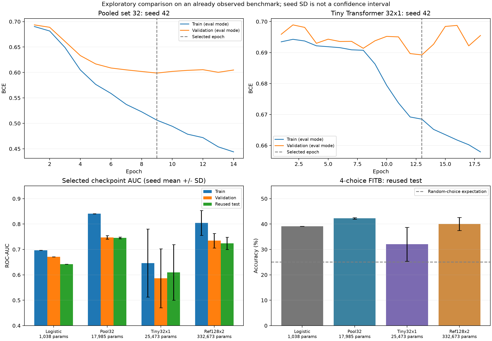

# 소형 코디 모델 비교 및 과적합 분석

작성일: 2026-11-18 · RTX 3070 Ti 8GB · 실행 `training/runs/small_comparison_01`.

## 결론

**이번 고정 조건에서 다음 검증 후보는 평균 풀링 소형 모델(Pool32)이다. 하지만 과적합을 해결한 모델은 아니다.**

Pool32는 기존 2층 Transformer보다 학습 파라미터가 94.6% 적고, 동일한 재사용 테스트에서 평균 ROC-AUC 0.746 / FITB 42.23%를 기록했다. 기존 Transformer의 0.724 / 40.03%보다 수치상 높고 seed 편차도 작았다. 반면 학습–검증 AUC 차이는 0.093으로 기존 0.070보다 커졌다. 모델 축소가 과적합을 자동으로 해결한다는 가설은 이번 실험에서 지지되지 않았다.

1층 소형 Transformer는 평균 AUC 0.610, FITB 32.04%로 낮고 seed 차이가 컸다. 현재 설정에서는 더 작은 attention 모델이 좋은 대안이라고 볼 수 없다. 다만 모델별 최적 학습률이나 warmup을 따로 탐색하지 않았으므로 구조 자체의 보편적인 우열을 뜻하지 않는다.

**테스트셋은 이전 실험에서 이미 확인했다.** 이번 비교는 새 독립 검증이 아닌 후속 탐색이다. 새로 학습한 모델의 체크포인트는 검증 BCE로만 선택했고, 테스트에서 잘 나온 seed를 골라 제품 모델로 바꾸지 않았다. 웹 추천은 기존 Qwen을 유지했다.

## 1. 비교 질문

1. 기존 Transformer의 크기를 줄이면 학습–검증 차이가 줄어드는가?
2. attention 없이 평균·분산 풀링만으로 비슷한 궁합 분류와 옷 선택 성능을 얻을 수 있는가?
3. seed가 바뀌어도 결과가 유지되는가?

첫 실험의 문제는 [초기 학습 보고서](OUTFIT_TRAINING_LOCAL_REPORT.md)에 있다. 기본 모델의 11 epoch 이후 학습 손실만 낮아지는 모습이 관찰돼 이번 비교를 진행했다.

## 2. 데이터와 통제 조건

동일한 공식 Polyvore revision `22cc0c748c293a598e1df561a76abe96273cb76a`의 정제 데이터와 **동일한 동결 ResNet18 IMAGENET1K_V1 특징 캐시**를 사용했다. 이미지를 다시 추출하거나 새 데이터를 섞지 않았다. 기존 실험의 benchmark SHA256과 일치하는지 실행 전에 확인했다.

| 분할 | 코디 분류 예제 | FITB 문항 |
|---|---:|---:|
| 학습 | 17,492 | 사용 안 함 |
| 검증 | 917 | 147 |
| 재사용 테스트 | 23,238 | 10,227 |

분할 간 의류 ID·이미지 바이트·정규화 픽셀·동일 dHash/종횡비 후보를 제외한 기존 정제를 유지했다. 이 검사가 모든 유사 이미지나 실제 동일 의류의 다른 사진까지 제거했다는 뜻은 아니다. 양성은 curated 코디, 음성은 원본 데이터의 합성 부정 예제다.

새 모델은 모두 seed 42/43/44, AdamW lr=0.0003, weight decay=0.1, dropout=0.3, batch=256, gradient clip=1.0을 사용했다. 최대 30 epoch, 검증 BCE 개선량 0.0001 미만이 5회 이어지면 중지했다. 별도 하이퍼파라미터 탐색은 하지 않았다. 기존 기준 모델·Transformer 결과는 같은 benchmark의 저장된 결과를 사용했으며 새로 재학습하지 않았다.

실행 계획·코드 해시를 `plan.json`에 먼저 저장하고, 6개 새 실행의 검증 체크포인트 선택을 전부 저장한 뒤 재사용 테스트를 평가했다. 기본 seed는 42다. 모델 가족이나 seed를 테스트 점수로 자동 선택하는 코드는 없다.

## 3. 모델 구성

| 모델 | 학습 파라미터 | 구성 | 이번 실행 여부 |
|---|---:|---|---|
| 이미지 Logistic | 1,038 | 이미지 특징 평균·표준편차 + 종류 비율 + 아이템 수, 선형 분류 | 기존 결과 재사용 |
| Pool32 | 17,985 | 이미지별 LayerNorm → 32차원 projection + 종류 embedding → GELU → masked 평균·표준편차 → 16차원 분류 헤드 | 3개 seed 실제 학습 |
| Tiny Transformer32×1 | 25,473 | 같은 이미지 정규화, hidden32, 1층/4-head attention, outfit token | 3개 seed 실제 학습 |
| 기존 Transformer128×2 | 332,673 | hidden128, 2층/4-head attention, outfit token | 기존 3개 seed 결과 재사용 |

모든 수치는 **궁합 헤드만**의 파라미터다. 공통으로 사용하는 동결 ResNet18은 제외했다. 파라미터 감소를 전체 이미지 처리 시간이나 서비스 지연 감소로 해석하면 안 된다.

Tiny Transformer는 기존 구조의 폭·깊이를 줄인 비교이고, Pool32는 집계 방법까지 바꾼 비교다. Pool32 결과로 파라미터 수 하나만의 인과 효과를 분리할 수는 없다. 기존 `CompatibilityModel`에는 기본값 2를 유지하는 `layers` 인자만 추가해 기존 모델의 구조와 체크포인트를 보존했다.

## 4. 전체 결과

신경망 수치는 3개 seed 평균 ± **표본 표준편차**다. 이는 신뢰구간이나 유의성 검정 결과가 아니다. Logistic은 기존 단일 fit이다. AUC는 적합도 분류의 구분 능력이며 어울릴 확률이나 정확도 백분율이 아니다. FITB는 네 후보 중 정답 선택 정확도이며 무작위 기대값은 25%다.

| 모델 | 학습 AUC | 검증 AUC | 재사용 테스트 AUC | 재사용 테스트 FITB | 학습−검증 AUC 차이 |
|---|---:|---:|---:|---:|---:|
| 이미지 Logistic | 0.697 | 0.671 | 0.642 | 39.10% | 0.026 |
| Pool32 | 0.841 ± 0.001 | 0.748 ± 0.007 | **0.746 ± 0.003** | **42.23% ± 0.26%p** | **0.093** |
| Tiny Transformer32×1 | 0.646 ± 0.134 | 0.586 ± 0.116 | 0.610 ± 0.109 | 32.04% ± 6.71%p | 0.060 |
| 기존 Transformer128×2 | 0.805 ± 0.049 | 0.735 ± 0.029 | 0.724 ± 0.024 | 40.03% ± 2.53%p | 0.070 |

Pool32의 재사용 테스트 AUC는 기존 Transformer보다 약 0.022 높았고 FITB는 약 2.20%p 높았다. 그러나 새 독립 테스트나 의류 의존성을 반영한 통계 검정을 수행하지 않았으므로 유의한 일반화 개선이라고 단정하지 않는다. 검증 FITB도 147개에 불과하다.

선택한 체크포인트의 **검증 BCE − 학습 eval BCE**는 Pool32 평균 0.0848, 기존 Transformer 0.0828, Tiny Transformer 0.0292, Logistic 0.0046이다. Pool32의 손실 차이 역시 기존보다 명확히 작아졌다고 볼 수 없다.

### seed별 새 실행

| 모델 | seed | 선택 / 마지막 epoch | 재사용 테스트 AUC | FITB | 검증 FITB |
|---|---:|---:|---:|---:|---:|
| Pool32 | 42 | 9 / 14 | 0.7491 | 42.40% | 45.58% |
| Pool32 | 43 | 9 / 14 | 0.7450 | 42.36% | 40.82% |
| Pool32 | 44 | 9 / 14 | 0.7427 | 41.93% | 44.90% |
| Tiny Transformer | 42 | 13 / 18 | 0.5895 | 30.36% | 23.13% |
| Tiny Transformer | 43 | 28 / 30 | 0.7280 | 39.43% | 33.33% |
| Tiny Transformer | 44 | 5 / 10 | 0.5121 | 26.33% | 23.81% |

Pool32는 모두 epoch9를 선택했다. Tiny Transformer seed43은 최대 epoch에 도달했고, 다른 두 seed는 낮은 성능에서 중지됐다. 이 차이는 현재 학습 조건의 최적화 불안정·학습 부족 가능성을 보여준다. 원인을 분리한 추가 실험은 하지 않았다.

## 5. 과적합 해석



위 두 패널의 새 모델 학습·검증 손실은 **모두 eval mode**다. 따라서 이전 그래프의 학습 dropout 활성/검증 비활성 차이 없이 비교할 수 있다. 패널별 y축 범위가 다르므로 그림의 틈 크기보다는 실제 손실 숫자를 확인해야 한다. 아래 막대의 오차는 seed 표준편차다.

Pool32 seed42의 epoch9 학습 eval BCE는 0.5062, 검증 BCE는 0.5988이다. epoch14에서는 학습 손실이 0.4439까지 내려가지만 검증 손실은 0.6049다. 후반에는 학습에만 더 잘 맞는 현상이 여전히 뚜렷하다. 조기 종료가 epoch9 가중치를 선택했지만, 선택 시점에도 차이가 남는다.

Tiny Transformer는 일부 실행에서 두 손실이 0.69 근처에 머문다. 이때 작은 격차는 충분한 일반화의 증거가 아니라 **제대로 학습하지 못한 결과일 수 있다**. 과적합 지표 하나만 최소화하면 성능 없는 모델을 고를 수 있다는 예다.

따라서 확인된 결론은 다음과 같다.

1. 작은 평균 풀링 모델도 이 특징·라벨에서 유용한 패턴을 학습한다. 복잡한 attention이 필수라는 근거는 얻지 못했다.
2. 모델을 작게 해도 학습–검증 격차가 저절로 사라지지 않는다.
3. 일반화 성능, seed 안정성, 실제 옷 선택 성능을 함께 봐야 한다.
4. 모델 크기뿐 아니라 데이터 독립성·라벨 품질·도메인 차이를 다음 실험의 중심에 두어야 한다. 어느 요인이 얼마나 영향을 주는지는 아직 분리하지 않았다.

## 6. 실행·검증·결과물

새 모델 6개를 실제 CUDA에서 학습하고 평가했다. Pool32 학습+평가 시간은 실행별 약 8.2~8.4초, Tiny Transformer는 약 8.0~24.1초였다. 매 epoch 평가와 최종 검증 FITB는 포함하고, 특징 로딩·최종 테스트 FITB 등은 이 시간에서 제외한다. 기존 학습 보고서의 전체 60.2초와 작업 범위가 달라 직접 속도 비교하지 않는다. 서비스 업로드 지연이나 head 추론 성능 벤치마크도 아니다.

모델의 순서 불변성·패딩 무시·유한 gradient·크기를 확인하는 테스트를 추가했다. 학습 관련 Python 테스트는 **14개 통과**했다. 웹 동작 코드는 바꾸지 않았고 이번 작업에서 웹/GPU 브라우저 E2E를 다시 실행하지 않았다.

- [실행 원문 JSON](SMALL_MODEL_COMPARISON_RUN.json)
- [모든 실행 CSV](SMALL_MODEL_COMPARISON.csv)
- `training/runs/small_comparison_01/plan.json`: 실행 전 고정한 조건과 코드 해시.
- 같은 폴더의 `*_history.json`, `*_validation.json`, `*.pt`, `*_test_predictions.npz`: 학습 곡선·선택·가중치·예측.
- `training/small_models.py`, `compare_small_models.py`, `plot_small_comparison.py`, `test_small_models.py`: 구현과 검증.

```powershell
# workspace 루트에서. 이미 완료된 비교 경로는 재실행을 거부한다.
lion_personal/training/.venv/Scripts/python.exe -m unittest discover -s lion_personal/training -p 'test_*.py'
lion_personal/training/.venv/Scripts/python.exe lion_personal/training/compare_small_models.py
lion_personal/training/.venv/Scripts/python.exe lion_personal/training/plot_small_comparison.py
```

추가 실행은 별도 RUN 경로와 새 계획을 사용해야 하며 기존 결과를 삭제해 같은 실험인 것처럼 재작성하지 않는다.

## 7. 진행 방향

Pool32를 **다음 검증 후보**로 유지하고, 현재 웹을 바로 교체하지 않는다. 우선 새로 확보한 실제 의류로 완성 코디를 만들고 블라인드 사람 평가를 수집해야 한다. 같은 후보에 대해 현재 Qwen·Logistic·Pool32를 비교하되, 새 의류 그룹의 일부는 최종 평가용으로 잠근다. 기존 사진 60장은 이미 개발에 사용됐으므로 독립 최종 검증이라고 부르지 않는다.

다음 개발에서는 사람 라벨·실제 의류 그룹·검증 표본 수·미등록 사진의 도메인 차이를 보강한다. 이후 규제 강도나 학습 목표를 바꿀 때도 작은 사전 탐색 예산을 고정하고 새 보류 평가를 지켜야 한다. 이번 재사용 테스트의 점수를 계속 올리는 방식으로 추천 품질을 입증하지 않는다.

현재 결과는 논문 전체 재현, 패션 정답, 어울릴 확률, 구매 범용성·개인화 성능을 의미하지 않는다. 전체 개발 맥락과 다음 AI를 위한 파일 지도는 [GPU 실험 이후 전체 인계 보고서](GPU_EXPERIMENT_FULL_HANDOFF.md)에 정리했다.
